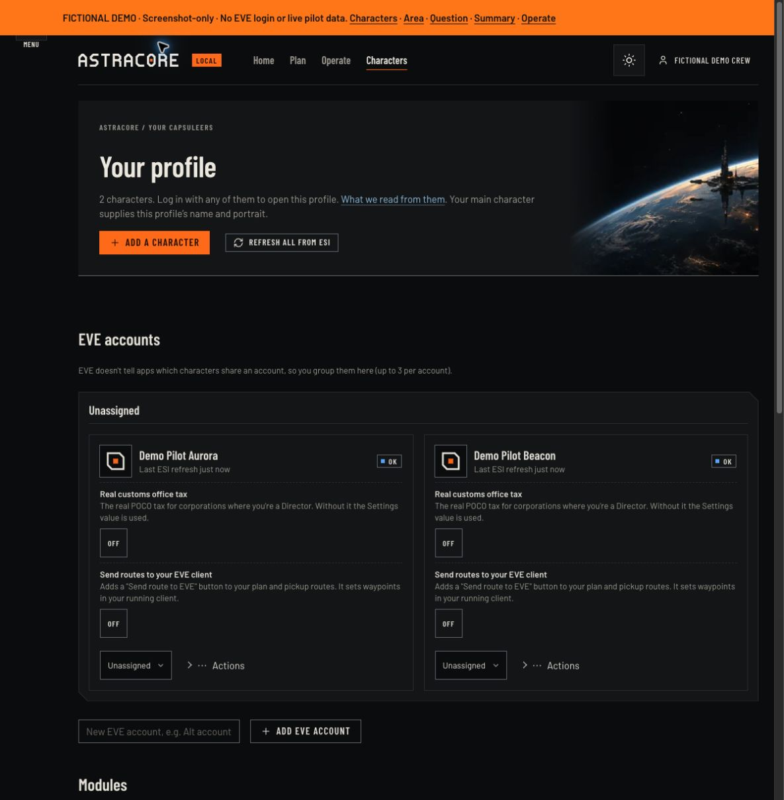
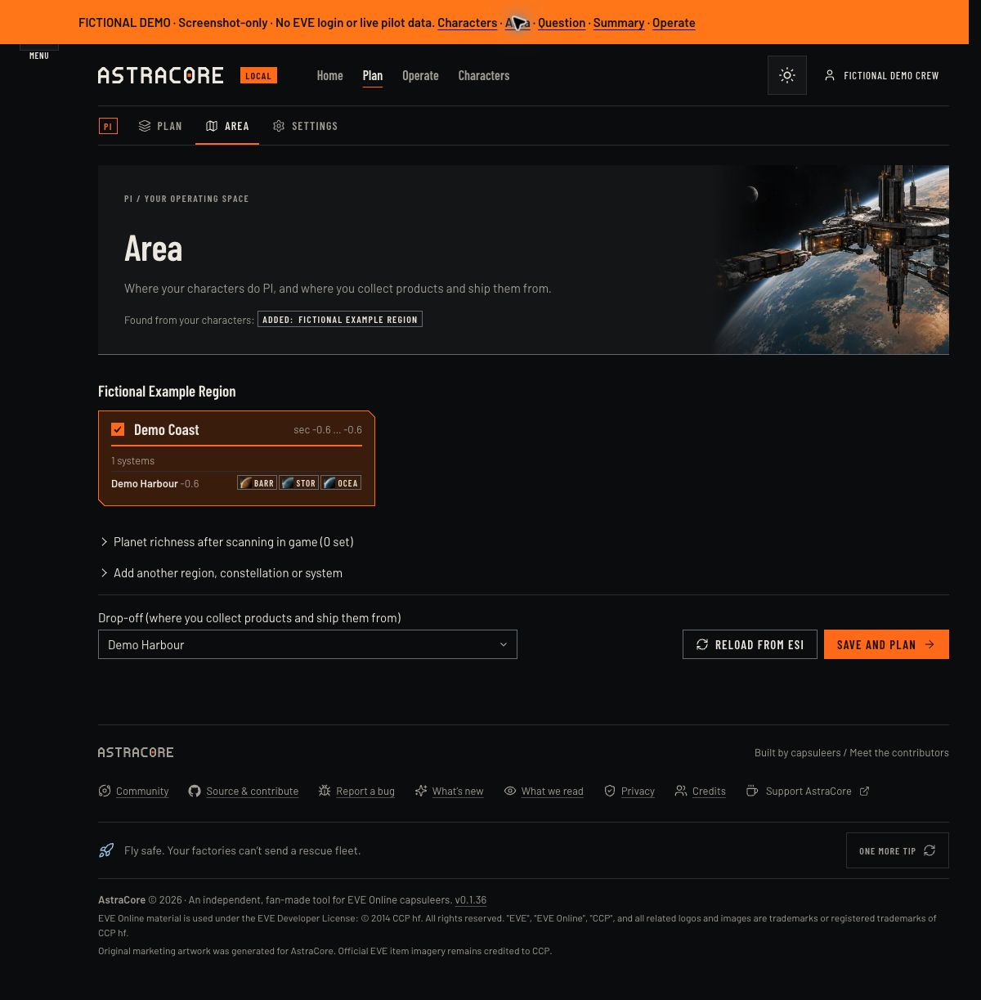
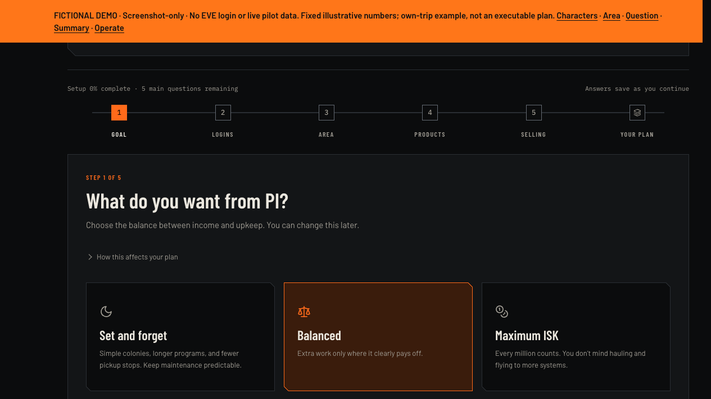
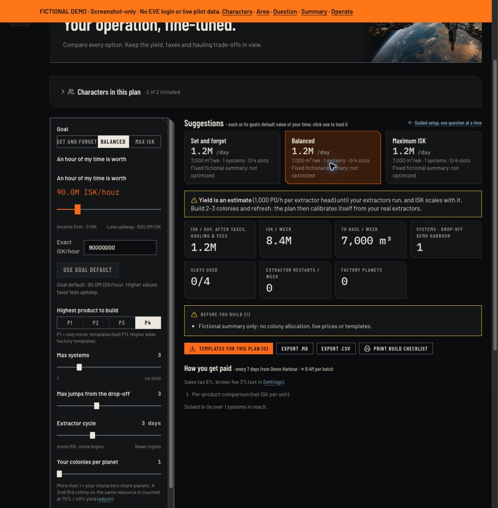
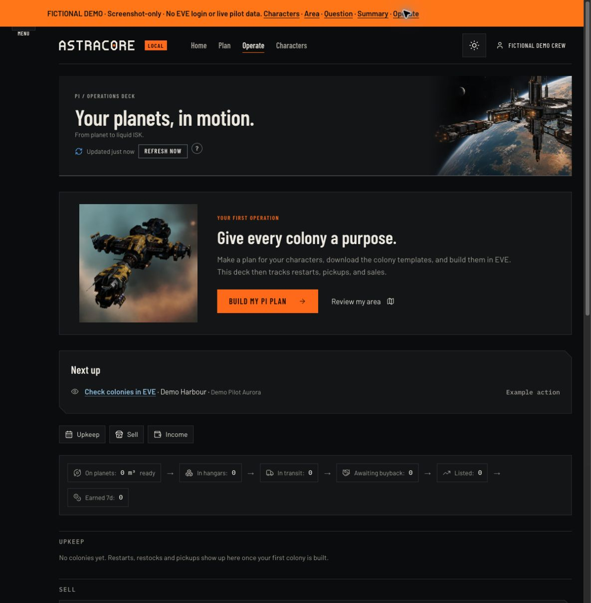

# A fictional tour of AstraCore PI

This tour uses **fictional pilots, locations and illustrative numbers**. The screenshots show the current PI interface, not a real account, live prices, a working production chain or a promise of income. No future modules are presented as available.

AstraCore helps you plan and operate planetary industry in EVE Online. It reads permitted character data; you still build colonies, restart extractors, move cargo, create contracts and sell products in EVE yourself.

## Trailer

A 60-second cinematic trailer plays from the home page hero. Its story, source and rebuild steps are in
[trailer/README.md](trailer/README.md).

## Narrated walkthrough

[Open the video player](walkthrough.html), [download the MP4](walkthrough.mp4), or read the
[English transcript](walkthrough.md). The video has synthetic English narration and visible
captions; [SRT captions](walkthrough.srt) are available separately, and the HTML player
offers English captions that stay readable on a narrow screen. It is a 60–90 second
screenshot tour, using only the isolated fictional runner. The fixed summary is not an
optimized or executable colony plan, and the video shows no live EVE actions.

The original captures record the v0.3.13 interface. The guided question was refreshed from
v0.3.21 to show the five main questions and simpler answer details. Later changes may alter
the layout; capture commits and narration are recorded in [the storyboard](video-storyboard.json). The runner
compatibility fix is tracked in [#196](https://github.com/gwnmikedus/AstraCore/issues/196).

## Guided planning

1. **Characters and Area.** A real pilot connects each character separately through EVE SSO. PI skills and available colony slots determine what the planner can use. Review the Area found from your colonies and alliance sovereignty, or add your operating region. Choose constellations and the drop-off where products are collected. The example crew and Demo Harbour below are entirely fictional.

   

   

2. **Choose a routine.** Start with your goal: Set and forget, Balanced or Maximum ISK. The five main questions are Goal, Logins, Area, Products and Selling. More options shows the existing Planets, Teamwork and Batches settings and lets you adjust them. On a real account the comparisons use your characters, settings and available data. In this screenshot runner every comparison uses the same illustrative fixture; it does not optimize your answers or save changes.

   

3. **Review the plan and assumptions.** Real results list assigned planets, production, inputs, time, hauling and selling assumptions. Yield remains an estimate until colony data can calibrate it; prices, order depth and demand can change. Compare effort as well as income, and inspect warnings before building. The illustrated summary below deliberately has no colony allocation or template download and is not an executable plan.

   

4. **Build in EVE.** Real plans refer to [DalShooth's PI templates](https://github.com/DalShooth/EVE_PI_Templates). AstraCore does not author or generate in-game templates. Buy the required command centers and starter inputs, follow the build checklist, and refresh after opening colonies in EVE. This runner disables exports, saving and EVE actions.

## Operate, hauling and selling

Open Operate after building. **Next up** brings attention to actions such as an extractor restart, a pickup or a factory restock. Colony stock is projected from the last ESI-visible state; ESI updates a colony after you open it in game. Check the freshness and actual colony before acting. The action below is labelled as an example, not an urgent live reminder.



Collect products at your chosen drop-off. Check routes, your ship's capacity and actual docking access. If characters cooperate, move inputs between them yourself. AstraCore does not fly, haul or place structures for you.

Review selling options and net proceeds after taxes, fees and hauling. Where available, buyback, courier-to-buy-order and sell-order choices involve different delays and effort. Thin orders, minimum courier fees and slow sales can make a quoted price unachievable. Read provider terms and verify current availability before creating a real contract. AstraCore's estimates are not guaranteed earnings.

## Create another safe capture

From an isolated worktree with the normal Python dependencies installed:

```sh
PYTHONPATH=src python scripts/demo_preview.py --port 19115
```

Open `http://127.0.0.1:19115/demo/characters`. The orange banner links to Characters, Area, a guided question, an illustrative summary and Operate. Use a desktop or narrow viewport and keep the fictional banner visible in each capture.

The runner binds only to loopback, creates a new temporary data directory, replaces inherited application configuration, uses negative fictional character IDs with generic local artwork, stores no EVE tokens, and blocks outgoing application HTTP requests. It disables EVE login, refresh, exports and mutation routes. On exit its temporary directory is removed. It is a screenshot tool, **not a public demo hosting mode**; do not tunnel or deploy it. The ordinary app is unchanged.

### Render the video locally

The renderer reads only the committed images in `video-screens/` and the storyboard. It
does not open the app, access a database, or contact a service. Rendering requires FFmpeg
with H.264/AAC, drawtext and libass support, an installed English macOS `say` voice, and a
local font. These are authoring tools, not application dependencies or bundled binaries.

```sh
python scripts/render_demo_video.py --ffmpeg /path/to/ffmpeg \
  --font /System/Library/Fonts/Supplemental/Arial.ttf --voice Samantha
```

The command creates the MP4, synchronized SRT/WebVTT captions and Markdown transcript in this
folder, replacing those generated files and refreshing the saved player’s embedded captions. Voice/font availability and output timing may
vary by machine; the renderer rejects a duration outside 60–90 seconds. Recheck playback,
caption readability, audio and the fictional labels after regeneration. The HTML player
starts muted so opening it does not unexpectedly play narration; enable sound to hear it.

## Credits and limits

AstraCore is built by capsuleers, with CosmicCarrot's PI work in its origins and contributors recognised in the app's Credits page. EVE Online and official item imagery belong to CCP hf; AstraCore is an independent fan-made tool. DalShooth maintains the PI templates. VOC is an independent hauling/buyback provider; its services are not operated by AstraCore. See [third-party sources](../third-party.md), [THIRD_PARTY_NOTICES](../../THIRD_PARTY_NOTICES.md) and the app's Credits page for terms and attribution. Original marketing artwork was generated for AstraCore.

This English screenshot tour covers currently available PI features only. English is the product standard; Dutch translation [#82](https://github.com/gwnmikedus/AstraCore/issues/82) is closed as not planned. The video completes the walkthrough material under [#115](https://github.com/gwnmikedus/AstraCore/issues/115); it is not a live demo, pilot beta or evidence of profitability.
